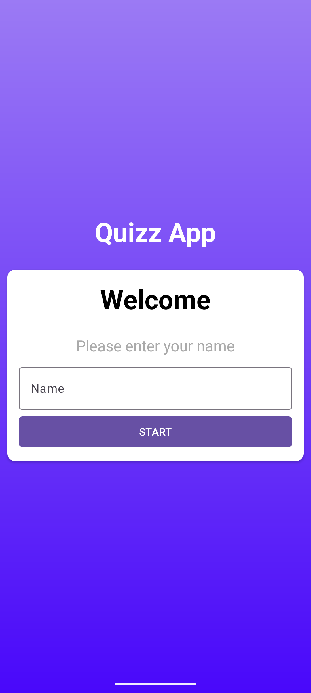
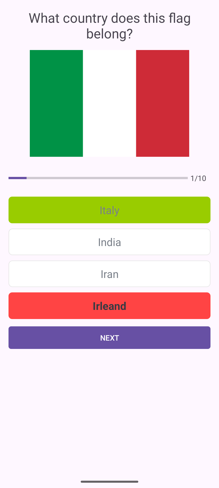
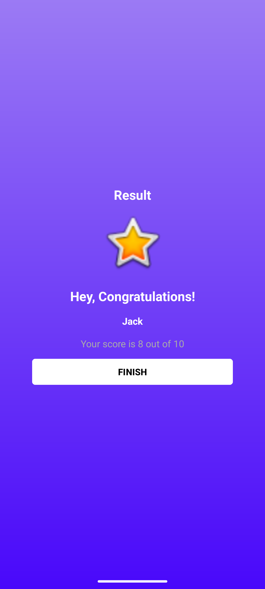

# QuizzApp - Flag Quiz Android Application

[](https://developer.android.com/)
[](https://kotlinlang.org/)
[](https://developer.android.com/about/versions/nougat)
[](https://developer.android.com/about/versions)

A native Android application designed to test and improve users' knowledge of world country flags. Built with **Kotlin**, modern **Android SDK** components, and clean **XML layouts**, QuizzApp delivers an intuitive, responsive, and visually interactive flag quiz experience.

---

## 📱 App Screenshots

| Welcome Screen | Quiz Screen | Result Screen |
| :---: | :---: | :---: |
|  |  |  |

---

## ✨ Features

- **User Onboarding & Validation:**
  - Interactive welcome screen where users enter their name.
  - Input validation that ensures a name is provided before starting the quiz.

- **Dynamic Quiz Engine:**
  - Multiple-choice questions for identifying national flags (including Italy, Argentina, Brazil, Finland, France, Germany, India, Poland, Romania, Spain).
  - Clean card layout featuring flag graphics and four selectable country options.

- **Interactive Answer Validation:**
  - Real-time feedback after selecting an answer and pressing "Check":
    - **Correct Selection:** Highlighted with a green border background.
    - **Incorrect Selection:** Highlighted with a red border background while revealing the correct answer.
  - Smooth option selection state and button label transitions ("Check" $\rightarrow$ "Next" $\rightarrow$ "Finish").

- **Progress & Score Tracking:**
  - Visual `ProgressBar` and text indicator displaying question progress (e.g., 1/10).
  - Dynamic score aggregation calculated as the user completes questions.

- **Personalized Results:**
  - Summary screen showcasing the player's name and total score (e.g., "Your Score is 8 out of 10").
  - Ability to finish and return to the main screen to start a new attempt.

- **Modern System UI Integration:**
  - Uses `enableEdgeToEdge()` and `WindowInsetsCompat` for modern Android edge-to-edge rendering and IME (soft keyboard) handling.

---

## 🛠 Tech Stack & Architecture

- **Language:** [Kotlin](https://kotlinlang.org/)
- **Minimum SDK:** API Level 24 (Android 7.0 Nougat)
- **Target / Compile SDK:** API Level 37
- **Build System:** Gradle with Version Catalogs (`libs.versions.toml`)
- **UI & Layouts:**
  - Native Android XML (`ConstraintLayout`, `CardView`, `MaterialButton`, `ProgressBar`, `ImageView`)
  - [Google Material Components](https://github.com/material-components/material-components-android) (`1.14.0`)
  - [AndroidX AppCompat](https://developer.android.com/jetpack/androidx/releases/appcompat) (`1.8.0`)
  - Custom XML Drawables for option state backgrounds (default, selected, correct, wrong)
- **Architecture & Data Flow:**
  - **Activity Navigation:** `MainActivity` $\rightarrow$ `QuestionsActivity` $\rightarrow$ `ResultActivity`
  - **Data Transfer:** Explicit Android `Intent` extras for passing user name, score, and total questions
  - **Data Models:** Kotlin `data class Question`
  - **Constants Repository:** `Constants` object encapsulating question creation and key identifiers

---

## 📂 Project Structure

```text
com.example.quizzapp
├── MainActivity.kt           # Onboarding screen & user name validation
├── model
│   └── Question.kt           # Question model (id, text, image, options, correctAnswer)
├── ui
│   ├── QuestionsActivity.kt  # Quiz gameplay, options rendering, check & next logic
│   └── ResultActivity.kt     # Quiz summary screen & score display
└── utlis
    └── Constants.kt          # Quiz questions dataset & Intent extra keys
```

---

## 🚀 Getting Started

### Prerequisites

- **Android Studio:** Ladybug (2024.2.1) or newer
- **JDK:** Java 11
- **Android SDK:** API 37 installed

### Running the Application

1. **Clone or download the project repository:**
   ```bash
   git clone https://github.com/your-username/QuizzApp.git
   ```
2. **Open in Android Studio:**
   - Launch Android Studio and click **Open**.
   - Navigate to the `QuizzApp` project directory and select it.
3. **Sync & Run:**
   - Wait for Gradle sync to complete successfully.
   - Select your Android Virtual Device (Emulator) or physical test device (API 24+).
   - Click the **Run** button (`Shift + F10`).

---

## 🎓 Tutorial Note

> **Note:** This project was developed as part of an educational mobile application tutorial to demonstrate native Android app development fundamentals in Kotlin, including Activity navigation, UI state updates, custom drawables, and intent extra passing.
